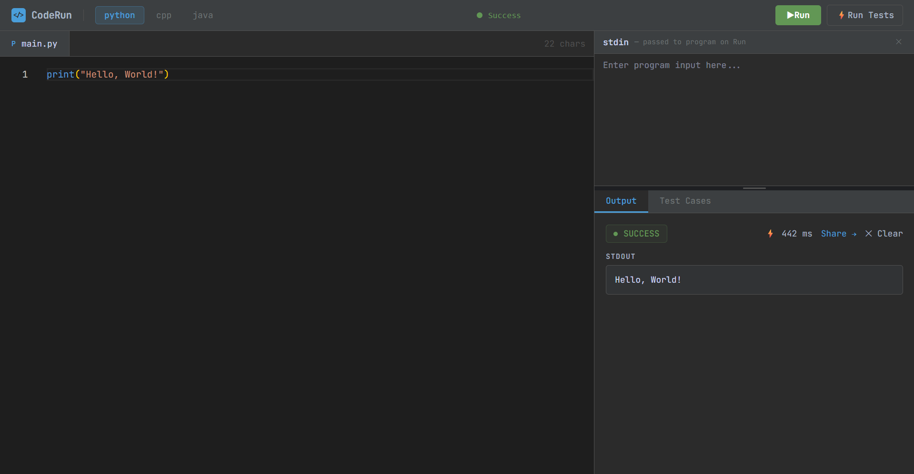
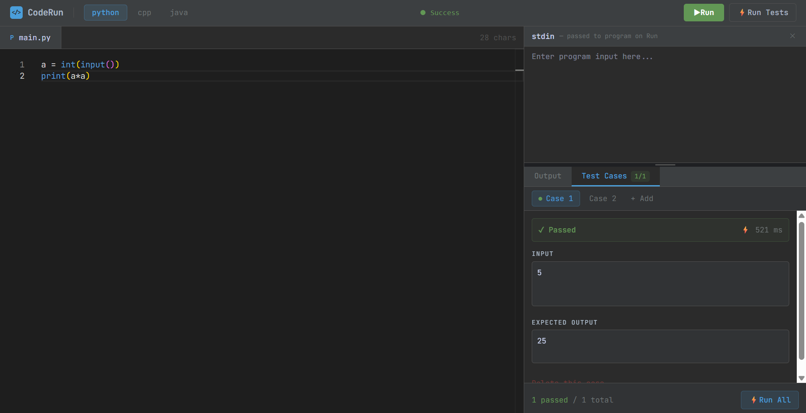
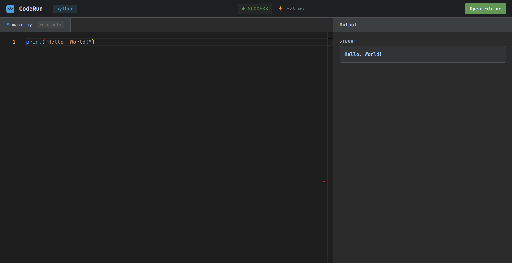

# CodeRun: Sandboxed Remote Code Execution Engine

Run untrusted Python, C++, and Java inside isolated Docker containers, with a Redis-backed job queue, backpressure, test-case validation, and shareable execution links.

| Editor + Execution | Test Case Runner | Share Page |
|---|---|---|
|  |  |  |

## Features

- Python 3.11, C++ (GCC), and Java 21, with stdin support
- One fresh Docker sandbox per run (one per test case in test runs): no network, 128MB RAM (no swap), PID limit, all capabilities dropped, 10s timeout
- Separate worker service runs up to 5 containers at a time; the API never touches the Docker socket
- Queue backpressure: when more than 15 jobs are waiting, the API answers `503` with `Retry-After` instead of piling on
- Multiple test cases with per-case status, actual output, and compiler/runtime errors
- Permalinks for executions (`/s/:id`) and history (last 20 runs, 7-day TTL); they work wherever the app is deployed, and the project is currently run locally
- Rate limiting (30 req/min per IP) and structured logging (Pino)

## Quick Start

**Prerequisites:** Docker Desktop (running), Node.js 18+

```bash
git clone https://github.com/poojithpagadekal/remote-code-executor
cd remote-code-executor
cp .env.example .env      # then set HOST_TEMP_PATH (see below)
docker compose up --build
```

Frontend: http://localhost:5173 | API: http://localhost:3000

`HOST_TEMP_PATH` is **required**: an absolute path to the `temp` folder in this repo on your machine. Sandbox containers are created by the host's Docker engine, so the bind-mount path has to be a host path, not a path inside the worker container. Compose refuses to start if it is missing.

> **Windows:** use forward slashes, e.g. `C:/Users/you/remote-code-executor/temp`.

## Architecture

```
React Frontend
      │  POST /api/execute
      ▼
API service  (validation, rate limit, queue-depth check)     no Docker socket
      │
      ▼
Redis  ◄──  Bull queue  +  execution history
      │
      ▼
Worker service  (5 concurrent jobs)                          only service with Docker socket
      │
      ▼
Sandbox container, one per run (Python / C++ / Java)
```

Four compose services: `frontend`, `api`, `worker`, `redis`.

1. The API validates the request and checks how many jobs are waiting. If accepting the request would push the waiting count above 15, it returns `503`. This is a soft limit: the check and the enqueue are not atomic, so a burst of simultaneous requests can briefly overshoot it.
2. Otherwise it adds a job to the Bull queue and waits for the result.
3. The worker takes the job, writes the code and stdin to UUID-named temp files, and starts a fresh container with those files mounted read-only.
4. It races the container's exit against a 10s timer, collects stdout/stderr, and removes the container.
5. The result goes back through the queue, the API stores it in Redis history (last 20, 7-day TTL), and responds.

## Design Decisions

- **Docker per submission:** every run gets a clean, isolated environment with hard resource limits.
- **Worker split from the API:** mounting `docker.sock` is effectively root on the host. Only the worker has it, so a bug in the public-facing API cannot start containers.
- **Queue for load control:** concurrency is capped at 5 containers, and queued jobs live in Redis rather than in API memory.
- **Backpressure instead of an unbounded queue:** under a worst case (every run is an infinite loop) capacity is only about 0.5 runs/s. Without a limit, clients time out while their jobs keep running, the queue fills with abandoned work, and latency grows without bound. The limit of 15 waiting jobs comes from the math: 15 waiting plus 5 running is about 5 waves of ~10.8s (~54s), which is meant to keep the slowest accepted request under the 60s client timeout in this worst-case workload (measured: 54.8s; it is a measurement, not a guarantee).
- **Three separate controls for three problems:** *concurrency control* (max 5 containers running), *backpressure* (reject new work when more than 15 jobs are waiting), and *rate limiting* (30 requests/min per IP). Concurrency protects the host, backpressure protects latency, and rate limiting stops one client from using everything.
- **Test cases:** each test case runs as its own job in its own fresh container. This keeps cases isolated from each other, but C++ and Java are compiled again for every case (compile-once is on the roadmap).
- **File-based stdin:** stdin is written to a temp file and redirected with `<`, which avoids shell interpolation.
- **Redis reused for history:** it already backs the queue, so no second data store is needed. TTL expires old records and `LTRIM` caps the list at 20.

## Security Model

| Threat | Mitigation |
|---|---|
| Network exfiltration | `NetworkMode: none` |
| Tampering with the mounted code/input files | Read-only bind mounts (Java compiles into `/tmp/out` inside the container). The container's own filesystem stays writable, and nothing on the host is mounted writable |
| Memory exhaustion | 128MB RAM, swap limit equal to RAM (hard cap) |
| Fork bombs | `PidsLimit` (100; 200 for Java) |
| Infinite loops | 10s timeout, `SIGKILL`, `AutoRemove` |
| Privilege escalation | `CapDrop: ALL`, `no-new-privileges` |
| Shell injection via stdin | File-based stdin, only server-generated UUID file names in commands |
| Container flooding / overload | 5 concurrent containers, queue-depth cap with `503` + `Retry-After` |
| Docker socket exposure | Only the worker mounts it; the API has no access |
| API abuse | 30 req/min per IP |

Containers share the host kernel, so this is not a defence against kernel exploits. See limitations.

## Performance

Measured locally on Docker Desktop (Windows) with [k6](https://k6.io); these are not production benchmarks. Results will vary with the machine and its Docker Desktop resource settings. Rate limiting was disabled for load tests, and each run started from an empty queue. Latencies are end-to-end request times, so they include queue wait and container startup.

| Test | Setup | Result |
|---|---|---|
| Throughput | Python hello world, 50 / 100 / 200 VUs | ~6.7 runs/s at every level, 0 failures; p95 latency 7.7s / 15.5s / 30.3s |
| Overload | Infinite-loop jobs, 80 VUs, 2 min | 65 accepted, 7,053 shed with `503`, shed-response p95 ~29ms, 0 failed requests, slowest accepted run 54.8s |

Throughput is flat as users increase: the 5 worker slots are the bottleneck, so latency grows roughly as users ÷ throughput. That is why the queue is bounded rather than the API scaled. Each run costs ~500-900ms, mostly container startup.

## API

| Endpoint | Input | Returns |
|---|---|---|
| `POST /api/execute` | `language`, `code`, `stdin` | `id`, `stdout`, `stderr`, `exitCode`, `status`, `executionTime` |
| `POST /api/execute/test` | `language`, `code`, `testCases` (`input` / `expected`) | per-case `status`, output and `stderr`, plus `passed`, `failed`, `total` |
| `GET /api/executions` | none | last 20 executions |
| `GET /api/executions/:id` | none | a single execution |

`status` is one of `success`, `compile_error`, `runtime_error`, `timeout`.
Errors: `400` invalid input, `429` rate limited, `503` queue full (retry after the `Retry-After` header).

## Limitations & Future Improvements

### Current limitations
- Output size is not capped: a program that prints endlessly can use memory until the 10s timeout. This should be fixed before exposing the service to the public
- No CPU limit and no disk quota inside the container's writable filesystem
- `NetworkMode: none` removes normal container networking; it is not a proof against every possible side channel
- Shared host kernel: Docker isolation is not a hardened multi-tenant boundary
- The worker holds the Docker socket; a bug there would still be serious
- Redis has no password and no persistence (reachable only on the compose network and `127.0.0.1`)
- Containers orphaned by a worker crash are not swept automatically
- Requests stay open until the job finishes (no job ID + polling yet)
- No user accounts, so history is global; no automated test suite yet

### Future improvements
- Output size cap, enforced while the output is being collected (not after the process finishes)
- Sweep for orphaned containers on worker start
- Job ID with polling, and shedding based on estimated wait time
- Pre-warmed container pool and compile-once for multi-test runs
- Redis password and persistence; Docker socket proxy or rootless Docker
- More workers across machines; Redis-backed rate limiter behind a load balancer
- Stronger isolation (gVisor / Firecracker)
- Automated tests and CI

## Load Testing

k6 scripts are in `loadtest/`:

```bash
k6 run --vus 50 --duration 30s loadtest/load-test.js      # throughput
k6 run --vus 80 --duration 120s loadtest/timeout-test.js  # overload / backpressure
```

Disable the rate limiter and start from an empty queue (`docker compose down && docker compose up -d`) so results are not contaminated.

## Tech Stack

| Layer | Technology |
|---|---|
| Frontend | React, Vite, TypeScript, Tailwind CSS |
| Editor | Monaco Editor |
| Backend | Node.js, Express, TypeScript |
| Queue | Bull (not BullMQ), Redis |
| Sandbox | Docker (dockerode) |
| Load testing | k6 |
| Logging | Pino |